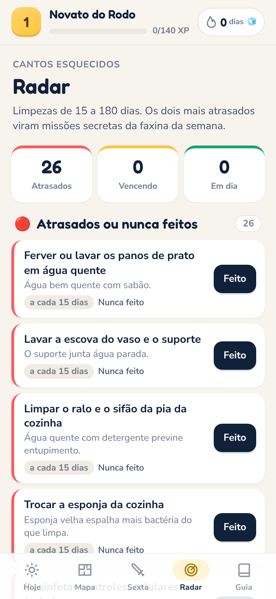
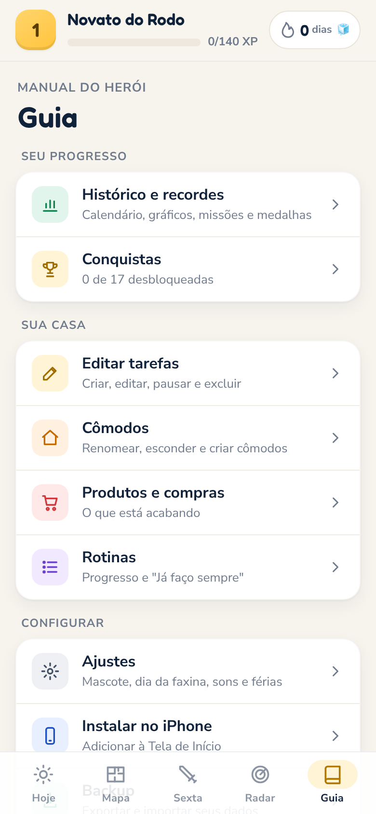

# Faxina Quest

Rotina de limpeza da casa, gamificada, em português do Brasil. É um PWA para instalar no **iPhone** pela opção "Adicionar à Tela de Início" do Safari. Funciona offline, e os dados ficam no próprio aparelho (IndexedDB).

| Hoje | Mapa | Sexta | Radar | Guia |
|---|---|---|---|---|
|  |  |  |  |  |

## O que tem

- **Hoje**: anel de progresso do dia, rotinas da manhã e da noite, a lavanderia do dia, o "Piloto automático" (recolhível) e o canto mais atrasado do radar.
- **Mapa**: planta baixa em SVG com 5 cômodos. Cada cômodo é pintado de baixo para cima conforme as tarefas da raid são concluídas (coral → amarelo → verde). Tocar num cômodo abre as tarefas dele.
- **Sexta (Raid)**: 7 fases (Preparação → Quarto → Escritório → Sala → Cozinha → Banheiro → Fechamento), cronômetro com recorde, combo de XP e 2 missões secretas vindas do radar.
- **Radar**: 26 cantos esquecidos com frequência de 15 a 180 dias.
- **Guia**: editor de tarefas, rotinas e "Já faço sempre", instalação no iPhone, lavanderia, vídeos, segurança, backup em JSON e conquistas.

### Regras de jogo

- XP: rotina +5, rotina de nível 2 +8, rotina consolidada +2, lavanderia +15, tarefa da raid +10 (+ combo), canto do radar +25, cômodo 100% +30, raid completa +100, semana de lavanderia +30, consolidação +50.
- O nível *n* exige `100 + 40·n` XP.
- A sequência conta o dia quando ≥ 70% das rotinas ativas (não consolidadas) foram feitas.
- Com 15 execuções a rotina **consolida**: confete, dica de "como manter", +50 XP e desbloqueio da rotina de nível 2.
- Combo: tarefas da raid marcadas com menos de 4 minutos entre si dão +2 XP por nível (máximo +10).

## Rodar localmente

Requer Node 20 ou mais recente.

```bash
npm install
```

```bash
npm run dev
```

O endereço aparece no terminal (por padrão, `http://localhost:5173/faxina-quest-app/`).

### Testes

```bash
npm test
```

Testes de lógica com Vitest: XP, nível, sequência, consolidação, desbloqueio, combo, radar e chaves de período.

```bash
npm run test:e2e
```

Testes com Playwright no viewport do iPhone 14 (390×844): marca tarefas da raid e confere que o cômodo pinta e o % muda no mapa, testa o editor e o modo offline e salva screenshots em `docs/screenshots/`.

### Build

```bash
npm run build
```

O resultado fica em `dist/`. Para conferir o build:

```bash
npm run preview
```

## Deploy

### GitHub Pages (já configurado)

O workflow `.github/workflows/deploy.yml` roda os testes, gera o build e publica no GitHub Pages a cada push na branch `main`.

1. No GitHub, abra o repositório e vá em **Settings → Pages**.
2. Em **Build and deployment → Source**, escolha **GitHub Actions**.
3. Faça merge na `main` (ou rode o workflow manualmente em **Actions → Deploy no GitHub Pages → Run workflow**).
4. O app fica em `https://<seu-usuário>.github.io/faxina-quest-app/`.

O caminho base vem do nome do repositório. Se renomear o repositório, nada precisa mudar no workflow.

### Vercel (alternativa)

Importe o repositório na Vercel. O `vercel.json` já define `BASE=/ npm run build` e a pasta `dist`.

## Instalar no iPhone, passo a passo

1. Abra o endereço do app no **Safari**.
2. Toque no botão **Compartilhar** (o quadrado com a seta para cima) na barra de baixo.
3. Role a lista e toque em **Adicionar à Tela de Início**.
4. Confirme o nome **Faxina Quest** e toque em **Adicionar**.
5. Abra sempre pelo ícone na Tela de Início. Instalado, o app abre em tela cheia, funciona sem internet e o iOS não apaga os dados.

Cada iPhone tem o próprio placar. Para levar o progresso para outro aparelho, use **Guia → Backup → Exportar** e depois **Importar** no outro celular.

## Estrutura

```
src/
  data/content.ts     tarefas, dicas, radar, vídeos, segurança e lavanderia
  logic/period.ts     chaves de dia, semana (segunda) e raid (sexta)
  logic/game.ts       regras de XP, nível, sequência, consolidação, combo e radar
  logic/state.ts      formato dos dados salvos
  db.ts               persistência com Dexie (IndexedDB)
  store.tsx           estado do app e recálculo ao voltar para o primeiro plano
  tabs/               Hoje, Mapa, Sexta, Radar, Guia e Editor
  components/         lista de tarefas, dica do mestre, modais e componentes de UI
e2e/                  testes Playwright
scripts/make-icons.mjs  gera os PNGs dos ícones a partir de public/favicon.svg
```

## Fase 2 (ainda não feita)

- Sincronizar o casal com Supabase (placar único, XP individual e da casa).
- Lembretes por Web Push (iOS 16.4+) ou um arquivo `.ics` para o Calendário.
